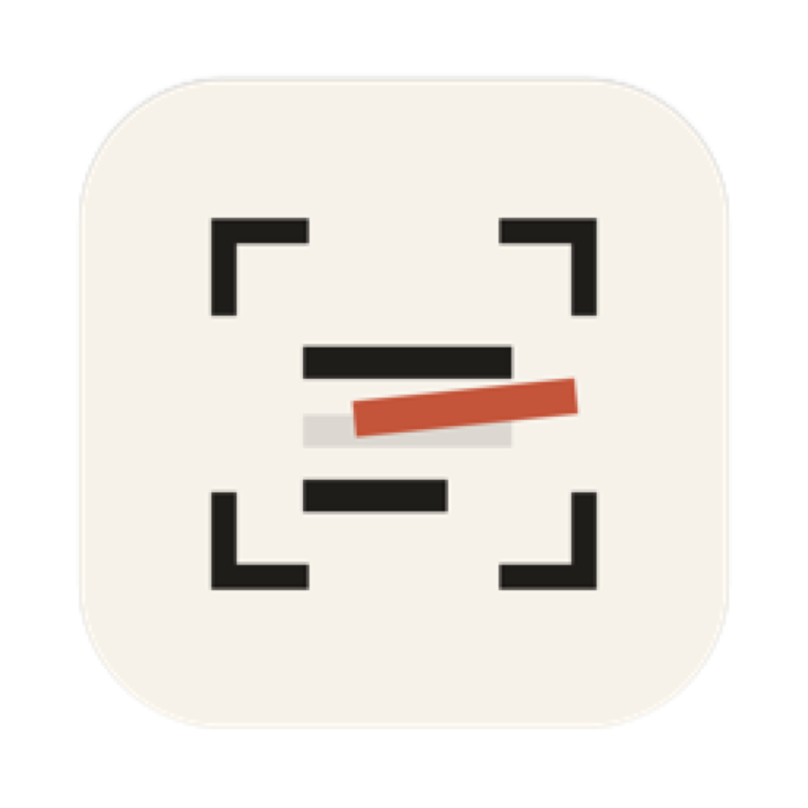
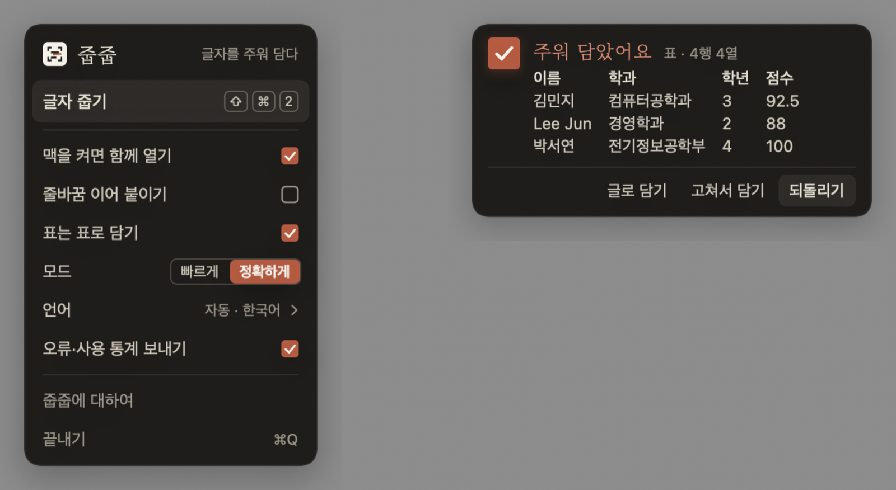
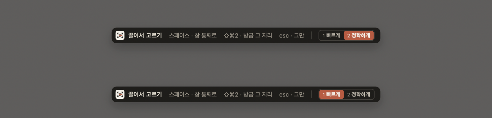

<p align="center">
  
</p>

<h1 align="center">줍줍</h1>

<p align="center">
  <b>화면에 보이는 글자를 단축키 한 번으로 주워 클립보드에 담아요.</b><br>
  표는 표로. 어떤 글자든 설정 없이. 먹과 한지의 조용한 디자인.
</p>

<p align="center">
  
  
  
  <a href="LICENSE"></a>
  
  <a href="https://github.com/nemodleo/jupjup/actions/workflows/ci.yml"></a>
</p>

<p align="center">
  <a href="README.md">English</a>
</p>

<p align="center">
  
</p>

## 왜 줍줍인가요

화면 글자 복사 앱은 많아요. 줍줍은 그 앱들이 못 하는 세 가지를 해요.

- **표는 표로 담아요.** 화면의 표를 고르면 넘버스·엑셀·구글 시트에 붙였을 때 칸이 그대로 나뉘어요. 클립보드에 탭 구분 글과 HTML 표를 함께 넣기 때문이에요. HTML 표 채점(`tools/table_bench.swift`)에서 칸 정확도 98%예요.
- **어떤 글자든 설정 없이 읽어요.** 한국어·일본어·중국어·키릴·태국어·아랍어·베트남어… 내 언어로 먼저 읽고, 안 되면 다른 문자권을 자동으로 다시 시도해요. 12개 언어 시험에서 97~100%였어요.
- **보고 있는 자리에서 진행과 완료를 보여 줘요.** 고른 자리에 주홍 괄호가 남아 읽는 동안 훑고, 다 되면 낙관이 찍혀요. 오른쪽 위 알림도 같은 몸짓이에요.

전부 맥 안에서만 돌아가요. 계정도 서버도 없어요. 횟수만 보내는 선택적 오류·사용 통계를 켜 두지 않는 한 아무것도 밖으로 나가지 않아요.

## 기능

| | |
|---|---|
| **단축키 하나** | ⇧⌘2(메뉴에서 바꿀 수 있어요) → 끌어서 고르기 → 클립보드에 담김 |
| **두 가지 모드** | *빠르게*(라이브 텍스트) / *정확하게*(Vision, 표, 다문자권). 메뉴에서, 또는 고르는 중에 **1** / **2** |
| **표** | 자동으로 알아보고 TSV + HTML로 담아요 |
| **창 통째로** | 고르는 중에 **스페이스** |
| **방금 그 자리** | 고르는 중에 단축키를 한 번 더 |
| **붙이기 전에 고치기** | 알림에 마우스를 올리면 한 줄로 잇기·고쳐서 담기·**되돌리기**(줍기 전 클립보드로) |
| **화면 언어 35개** | macOS 언어를 따라가요. 아랍어·히브리어는 오른쪽에서 왼쪽으로 |
| **바쁨 경고** | CPU가 바빠 느려질 것 같으면 미리 알려 줘요 |

<p align="center">
  
</p>

## 설치

줍줍은 **베타**이고 아직 애플 공증을 받지 않아서, 처음 열 때 macOS 경고가 떠요.

**소스에서 빌드하기** (지금은 이 방법을 추천해요)

```bash
brew install xcodegen          # 한 번만
git clone https://github.com/nemodleo/jupjup.git
cd jupjup
./build.sh                     # Universal 앱을 빌드해 /Applications에 설치하고 열어요
```

Xcode가 필요해요(26.3에서 확인). 첫 빌드는 Swift 패키지 두 개를 받느라 몇 분 걸려요.

**다운로드 배포** — 서명·공증된 파일은 [로드맵](#로드맵)에 있어요.

### 처음 켤 때

1. **⇧⌘2**를 눌러요. macOS가 **화면 기록** 권한을 물어요(화면을 읽으려면 화면을 볼 수 있어야 해요).
2. *시스템 설정 › 개인정보 보호 및 보안 › 화면 및 시스템 오디오 녹음*에서 줍줍을 켜요.
3. **줍줍을 다시 열어요.** 이 권한은 새로 켠 앱에만 적용돼요. 첫 실행 창에 *다시 열기* 버튼이 있어요.

> ⇧⌘2를 눌러도 반응이 없으면 다른 앱(TextSniper가 같은 기본값을 써요)이 그 조합을 쓰고 있는 거예요. 줍줍이 알려 주고 다른 조합을 고르게 해요.

## 고르는 중 쓰는 키

| 키 | 동작 |
|---|---|
| 끌기 | 영역 고르기 |
| 스페이스 | 창 통째로 고르기로 바꾸기 |
| 1 / 2 | 이번 캡쳐를 빠르게 / 정확하게(기본값으로도 저장) |
| ⇧⌘2(내 단축키) | 방금 그 자리 다시 |
| esc | 그만 |

## 어떻게 동작하나요

- **정확하게**는 애플 Vision 글자 인식을 써요. Vision은 목록의 첫 언어로 글자 모델 *하나*를 고르기 때문에, 줍줍은 내 언어로 먼저 읽고 시스템 언어 판별기로 결과를 확인한 뒤, 필요할 때만 다른 문자권 모델(일본어·중국어·키릴·태국어·아랍어…)로 다시 읽어요. Vision이 주는 낱말 상자는 표 알아보기에 쓰여요. 모든 행을 가로지르는 세로 통로를 찾는 방식이에요.
- **빠르게**는 라이브 텍스트(VisionKit)를 써요. 더 빠르고 가볍지만 낱말 위치가 없어서 표는 못 해요.
- 한쪽 엔진이 아무것도 못 읽으면 다른 쪽으로 한 번 더 시도해요.
- 전부 기기 안에서, `Sources/Recognizer.swift`에 있어요.

## 개인정보

줍줍은 읽은 내용을 저장하거나 올리거나 기록하지 않아요. 화면 이미지는 한 번 캡쳐하는 동안만 메모리에 있어요.

전체 방침: [PRIVACY.md](PRIVACY.md#한국어).

선택적인 **오류·사용 통계**(기본 켬, 메뉴나 첫 실행 창에서 한 번에 끔)는 *횟수와 분류*만 보내요. 예를 들면 "캡쳐 끝남, 2~5줄, 1초 미만, 표 아님" 같은 것이에요. [Sentry](https://sentry.io)(오류)와 [TelemetryDeck](https://telemetrydeck.com)(사용)으로 가요. 글자·이미지·좌표는 절대 보내지 않아요. 정확한 목록은 `Sources/Reporting.swift`에 있어요. 리포트 키 없이 빌드하면 아무것도 보내지 않아요.

## 필요한 것

- macOS 14 Sonoma 이상
- 애플 실리콘 또는 인텔(Universal 빌드). 인텔 맥은 뉴럴 엔진이 없어서 인식이 더 느려요.

## 로드맵

- [ ] Developer ID 서명과 공증(Gatekeeper 경고 없애기)
- [ ] 다운로드 배포와 앱 안 업데이트
- [ ] 기계 번역된 31개 화면 언어의 원어민 검수
- [ ] 복사 기록
- [ ] 맥 앱스토어

## 기여하기

이슈와 풀 리퀘스트를 환영해요.

- **번역**: 언어마다 `Resources/Strings/<코드>.json` 파일 하나예요. 문구를 고쳐서 PR을 열어 주세요. 코드는 몰라도 돼요.
- **표 인식**: `tools/table_bench.swift`에 사례를 더하고 돌려 보세요. 목표는 글자가 맞는 것이 아니라 칸이 맞는 거예요.
- **디자인**: 앱은 디자인 캔버스를 따라요(먹 `#1F1D1A`, 한지 `#E4DDCF`, 주홍 낙관 하나 `#C4553A`). 새 UI도 이 팔레트 안에서 부탁드려요.

## 고마운 분들

- 기기 안 인식을 해 주는 애플 Vision과 VisionKit
- 글꼴: [본명조(Noto Serif KR)](https://fonts.google.com/noto/specimen/Noto+Serif+KR)와 [Cormorant Garamond](https://fonts.google.com/specimen/Cormorant+Garamond), 둘 다 SIL Open Font License
- [Sentry](https://github.com/getsentry/sentry-cocoa), [TelemetryDeck](https://github.com/TelemetryDeck/SwiftSDK) SDK

## 라이선스

줍줍은 [GNU GPL v3](LICENSE) 자유 소프트웨어예요. 쓰고, 뜯어보고, 나누고, 고칠 수 있어요. 고친 버전을 배포할 때는 같은 라이선스를 지켜야 해요.

*줍다 — 바닥에 떨어진 것을 손으로 집어 들다.*
