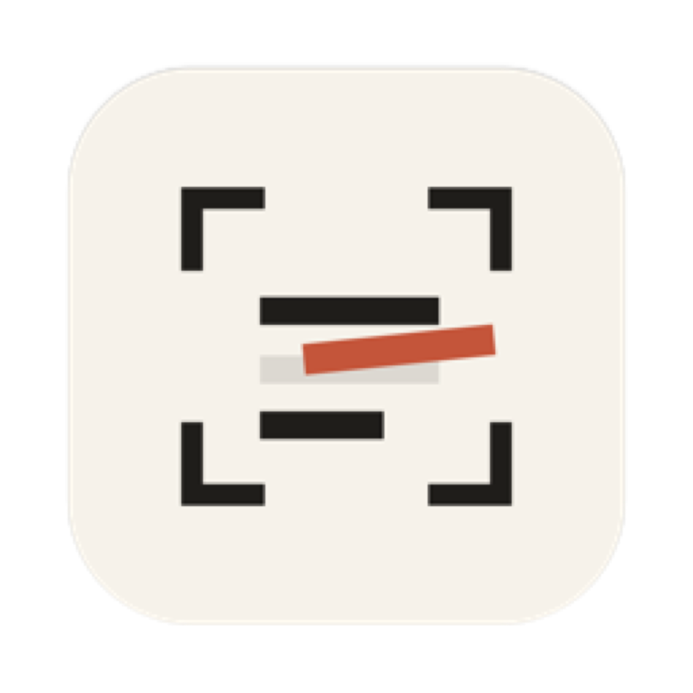
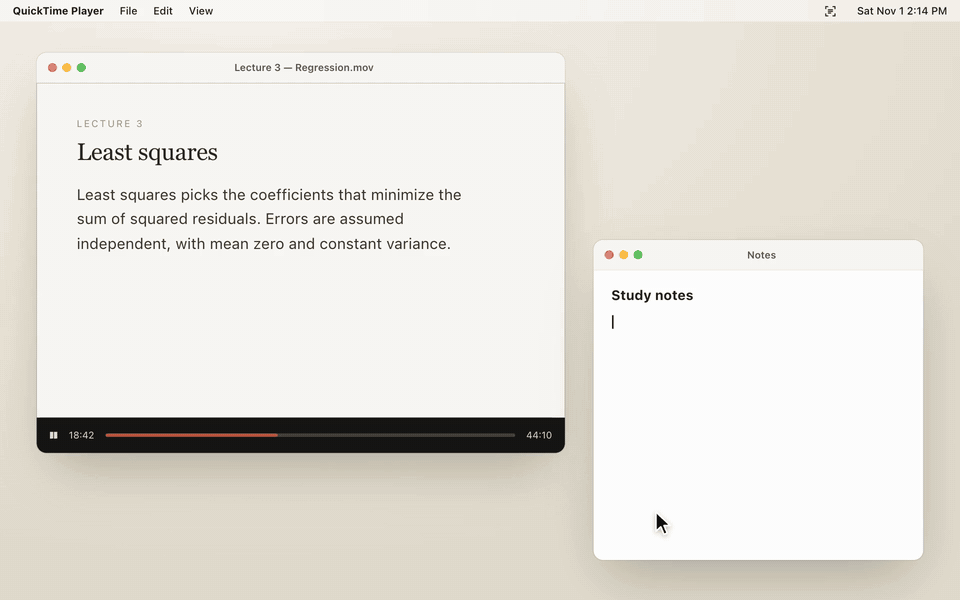
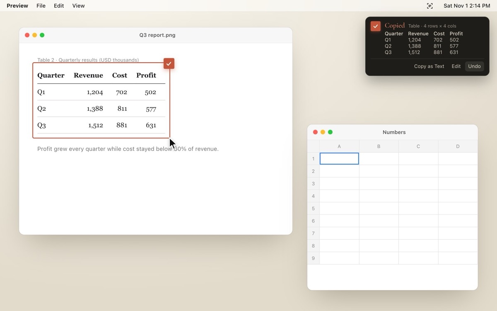
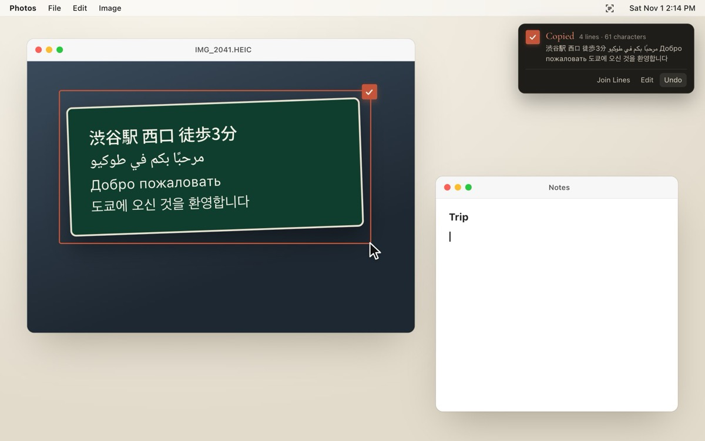
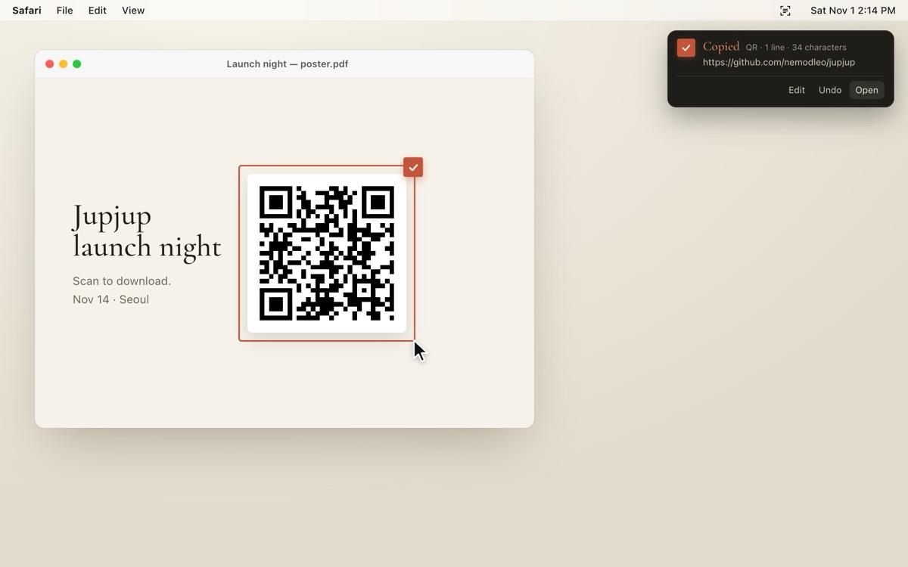
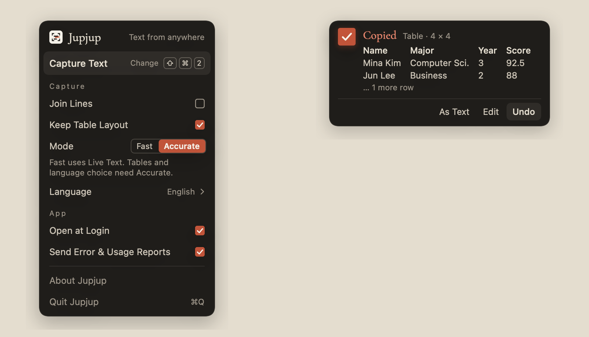
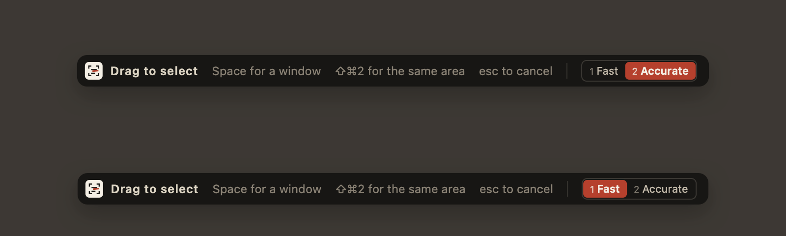

<p align="center">
  
</p>

<h1 align="center">Jupjup <sub>줍줍</sub></h1>

<p align="center">
  <b>Pick up any text on your Mac screen — one shortcut, straight to your clipboard.</b><br>
  Tables stay tables. Any script, no setup. Quiet, ink-and-paper design.
</p>

<p align="center">
  <a href="#install"></a>
  
  
  <a href="LICENSE"></a>
  
  <a href="https://github.com/nemodleo/jupjup/actions/workflows/ci.yml"></a>
</p>

<p align="center">
  <a href="https://jupjup.d-t-it.com"><b>jupjup.d-t-it.com</b></a> · <a href="README.ko.md">한국어</a>
</p>

<p align="center">
  <a href="https://jupjup.d-t-it.com/"></a>
</p>

## Why Jupjup?

There are plenty of screen-OCR tools. Jupjup does three things they don't:

- **Tables stay tables.** Select a table on screen and paste it into Numbers, Excel or Google Sheets with the cells intact. Jupjup puts both tab-separated text and an HTML table on the clipboard. 98% cell accuracy on our HTML-table benchmark (`tools/table_bench.swift`).
- **Reads any script without setup.** Korean, Japanese, Chinese, Cyrillic, Thai, Arabic, Vietnamese… Jupjup reads in your languages first and, if that fails, tries the other scripts automatically. 97–100% on 12 languages in our tests.
- **QR codes and barcodes, too.** Even styled ones (dotted, rounded, logo on top). If it is a link, the notification has an **Open** button. 46 of 47 hard cases in `tools/code_bench.swift`.

<table>
  <tr>
    <td width="33%" align="center"><br><sub>A table in a screenshot → Numbers</sub></td>
    <td width="33%" align="center"><br><sub>Four scripts on one sign</sub></td>
    <td width="33%" align="center"><br><sub>A QR code on a poster → Open</sub></td>
  </tr>
</table>

Everything runs on your Mac. No account, no server, nothing leaves the machine unless you keep the optional, counts-only crash/usage reports on.

## Features

| | |
|---|---|
| **One shortcut** | ⇧⌘2 (change it in the menu) → drag to select → the text is on your clipboard |
| **Two modes** | *Fast* (Live Text) or *Accurate* (Vision, tables, multi-script). Switch in the menu, or press **1** / **2** while selecting |
| **Tables** | Detected automatically; copied as TSV + HTML |
| **QR codes & barcodes** | Read alongside text in either mode; a link gets an **Open** button in the notification |
| **Whole window** | Press **Space** while selecting to pick a window instead |
| **Same spot again** | Press the shortcut again while selecting to reuse the last area |
| **Fix it before you paste** | Buttons right in the notification: join lines (⌘J), edit (⌘E), or **Undo** (⌘Z, restores your previous clipboard). Drag over the preview to copy just part of it |
| **History** | The last 20 copies, on your Mac only. Pick one in the menu to copy it again, in the same shape (one line, table, edited) |
| **35 interface languages** | Auto-follows macOS; right-to-left layout for Arabic and Hebrew |
| **Busy-Mac warning** | Tells you when a heavy CPU load will slow reading down |

<p align="center">
  
</p>

## Install

Jupjup is in **beta** and not yet notarized by Apple, so macOS will warn on first open.

**Build from source** (recommended for now)

```bash
brew install xcodegen          # once
git clone https://github.com/nemodleo/jupjup.git
cd jupjup
./build.sh                     # builds a Universal app, installs to /Applications, opens it
```

Requires Xcode (tested with 26.3). The first build downloads two Swift packages and takes a few minutes.

> If you rebuild often, run `tools/make_cert.sh` once. It creates a self-signed certificate ("Jupjup Dev") that `build.sh` then signs with, so macOS keeps the Screen Recording permission across rebuilds. Ad-hoc signatures change on every build, which makes macOS ask again each time.

**Download** — get the DMG from [jupjup.d-t-it.com](https://jupjup.d-t-it.com) (Universal, about 5 MB). It isn’t notarized yet: on first launch, open System Settings › Privacy & Security and click *Open Anyway*. The disk image includes the steps. Make your own with `tools/make_dmg.sh`.

### First launch

1. Press **⇧⌘2**. macOS asks for **Screen Recording** permission (Jupjup needs to *see* the screen to read it).
2. Turn Jupjup on in *System Settings › Privacy & Security › Screen & System Audio Recording*.
3. **Reopen Jupjup.** macOS only applies this permission to freshly launched apps. The first-run window has a *Reopen* button for this.

> If ⇧⌘2 does nothing, another app (TextSniper uses the same default) may own it. Jupjup tells you and lets you pick a different combo.

## Keys while selecting

| Key | Does |
|---|---|
| drag | select an area |
| Space | switch to picking a whole window |
| 1 / 2 | Fast / Accurate mode for this capture (also saved as the default) |
| ⇧⌘2 (your shortcut) | reuse the last area |
| esc | cancel |

<p align="center">
  
</p>

## How it works

- **Accurate mode** uses Apple's Vision text recognizer. Vision picks *one* script model from the first language you ask for, so Jupjup reads with your languages first, checks what came back with the system language detector, and re-reads with other script models (Japanese, Chinese, Cyrillic, Thai, Arabic…) only when needed. Word boxes from Vision feed the table detector, which looks for vertical gutters that run through every row.
- **Fast mode** uses Live Text (VisionKit). Faster, lighter, no word positions — so no tables.
- If one engine reads nothing, Jupjup tries the other before giving up.
- All of it is on-device, in `Sources/Recognizer.swift`.

## Privacy

Jupjup never uploads or logs what it reads. Screenshots live in memory for the duration of one capture. The only thing kept is the local history of your last 20 copies (turn off with *Keep History*).

Full policy: [PRIVACY.md](PRIVACY.md).

Optional **error & usage reports** (on by default, one click to turn off in the menu or the first-run window) send only *counts and categories* — "a capture finished, 2–5 lines, under a second, table: no" — to [Sentry](https://sentry.io) (crashes) and [TelemetryDeck](https://telemetrydeck.com) (usage). Never text, never images, never coordinates. The exact list is in `Sources/Reporting.swift`. Builds without report keys send nothing at all.

Once a day Jupjup also checks `jupjup.d-t-it.com/version.json` for a newer version (no cookies, no identifiers; turn off with *Check for Updates*). It only tells you in the menu; it never installs anything by itself.

## Requirements

- macOS 14 Sonoma or later
- Apple silicon or Intel (Universal build). Intel Macs have no Neural Engine, so recognition is slower there.

## Roadmap

- [ ] Developer ID signing and notarization (no more Gatekeeper warning)
- [ ] Downloadable releases and in-app updates
- [ ] Native-speaker review of the 31 machine-translated interface languages
- [x] Capture history
- [ ] Mac App Store

## Contributing

Issues and pull requests are welcome.

- **Translations**: each language is one file in `Resources/Strings/<code>.json`. Fix a string, open a PR — no code needed.
- **Table recognition**: add a case to `tools/table_bench.swift` and run it; the goal is cells-correct, not just text-correct.
- **Design**: the app follows a design canvas (ink `#1F1D1A`, hanji `#E4DDCF`, one vermilion seal `#C4553A`). Please keep new UI inside that palette.

## Acknowledgements

- Apple Vision and VisionKit for on-device recognition
- Fonts: [Noto Serif KR](https://fonts.google.com/noto/specimen/Noto+Serif+KR) and [Cormorant Garamond](https://fonts.google.com/specimen/Cormorant+Garamond), both under the SIL Open Font License
- [Sentry](https://github.com/getsentry/sentry-cocoa) and [TelemetryDeck](https://github.com/TelemetryDeck/SwiftSDK) SDKs

## License

Jupjup is free software under the [GNU GPL v3](LICENSE). You may use, study, share and improve it; if you distribute a modified version, it must stay under the same license.

*줍다 (jup·da), verb — to pick something up off the floor, one piece at a time.*
